# Отчёт по заданиям OpenMP 1–9

## Условия экспериментов

**Машина.** Ноутбук с Intel Core i7-13620H: 6 производительных ядер (P) с Hyper-Threading и 4 энергоэффективных (E).
Всего 10 физических ядер и 16 логических CPU, кэш L3 24 МБ. Компилятор GCC 15.2 (`-O2 -fopenmp`), OpenMP 4.5.

**Как измерялось.**
- Число потоков p = 1, 2, 4, 8 (меньше числа CPU), 16 (равно), 32 (больше).
- Время замеряется через `omp_get_wtime()`: один прогрев, затем берётся медиана из 5 запусков (в задаче 2 — из 15,
  в задаче 8 — из 9). Задача 1 перемерена после исправления доступа к общему минимуму.
- В столбце `speedup` CSV записано T(1) / T(p) для каждого варианта. В задачах, где сравниваются разные способы (5, 7, 8, 9), ускорение на графиках и в таблицах пересчитано
  относительно **однопоточной базовой версии**: S = T_посл / T(p). Так варианты можно сравнивать
  между собой. Для задачи 5 база своя у каждого типа матрицы. В задаче 8 база читает и считает по очереди, вызывая `dot` с одним потоком.
- Перед замерами варианты сверяются с эталоном. В задаче 6 эталон — цикл со `static` на одном потоке.
- Сырые данные лежат в `results/taskNN.csv`, полные таблицы — в `results/plots/taskNN.md`, все графики —
  в `results/plots/`.

## Задача 1. Минимум элементов вектора

**Как решено.** Вектор делится между потоками, каждый ищет минимум своей части, потом частичные минимумы
объединяются. Есть два варианта:
- **с редукцией:** `parallel for reduction(min : m)`. OpenMP сам заводит каждому потоку копию `m` и в конце
  объединяет копии. Операции min/max в `reduction` появились в OpenMP 3.1, у нас 4.5.
- **без редукции** — каждый поток считает приватный `lmin` в цикле `omp for nowait` и один раз
  входит в `critical`. Сравнение и обновление общего минимума выполняются внутри этой секции.

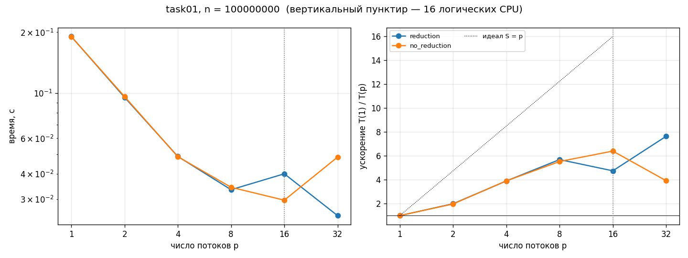
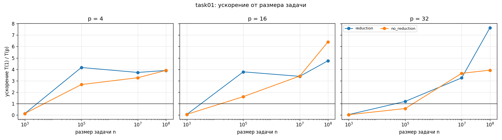

| n | S(4) | S(8) | S(16) | S(32) |
|---|---|---|---|---|
| 10³ | 0.13 / 0.13 | 0.13 / 0.11 | 0.05 / 0.06 | 0.04 / 0.03 |
| 10⁵ | 4.16 / 2.67 | 6.17 / 3.38 | 3.78 / 1.61 | 1.19 / 0.57 |
| 10⁷ | 3.73 / 3.26 | 5.07 / 3.25 | 3.39 / 3.41 | 3.25 / 3.65 |
| 10⁸ | 3.90 / 3.91 | 5.69 / 5.53 | 4.75 / 6.41 | 7.64 / 3.93 |

В каждой ячейке указаны ускорения с редукцией и без неё. У каждого варианта своя однопоточная база.

**Вывод.** При n = 10³ накладные расходы превышают выигрыш от деления работы. При n = 10⁸
на 4 и 8 потоках варианты близки по времени. На 16 и 32 потоках порядок вариантов меняется,
поэтому по этому замеру нельзя выбрать устойчивого победителя.

## Задача 2. Скалярное произведение

**Как решено.** `parallel for reduction(+ : s)`: итерации делятся поровну (`static`), у каждого потока своя
частичная сумма, в конце они складываются.

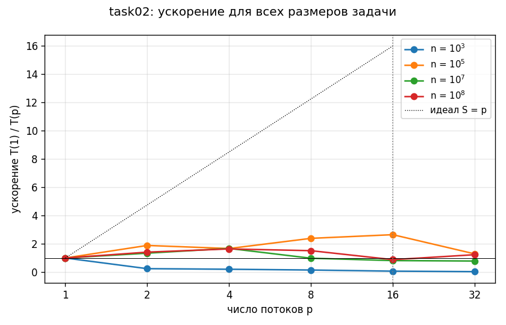

| n | S(2) | S(4) | S(8) | S(16) | S(32) |
|---|---|---|---|---|---|
| 10³ | 0.25 | 0.20 | 0.15 | 0.07 | 0.04 |
| 10⁵ | 1.9 | 1.7 | 2.4 | 2.7 | 1.3 |
| 10⁷ | 1.3 | 1.7 | 1.0 | 0.8 | 0.8 |
| 10⁸ | 1.4 | 1.6 | 1.5 | 0.9 | 1.2 |

**Вывод.** На пару элементов приходится 16 байт чтения, одно умножение и одно сложение. При n = 10⁸
лучший результат в этом прогоне — 1.64 при 4 потоках. При n = 10⁵ оба вектора занимают 1.6 МБ,
и ускорение достигает 2.65 при 16 потоках.

## Задача 3. Интеграл методом прямоугольников

**Как решено.**
- Формула: y ≈ h · Σ f(a + i·h), i = 0 … N−1, h = (b − a)/N. Для проверки берётся ∫₀^π sin x dx = 2.
- Цикл `parallel for reduction(+ : s)`.
- Важная деталь: x вычисляется из номера итерации (`a + i*h`), а не накапливается (`x += h`). Иначе каждая
  итерация зависела бы от предыдущей, и цикл нельзя было бы поделить между потоками.
- Погрешность: 1.6·10⁻⁶ при N = 10³ и 2·10⁻¹⁴ при N = 10⁷.

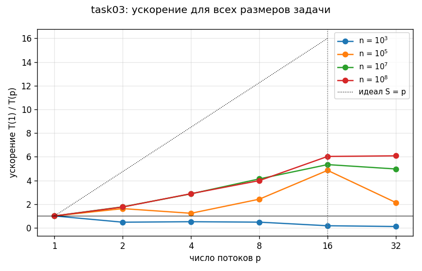

| N | S(2) | S(4) | S(8) | S(16) | S(32) |
|---|---|---|---|---|---|
| 10³ | 0.47 | 0.51 | 0.48 | 0.17 | 0.11 |
| 10⁵ | 1.6 | 1.2 | 2.4 | 4.9 | 2.1 |
| 10⁸ | 1.8 | 2.9 | 4.0 | 6.0 | 6.1 |

**Вывод.** Основная работа — вызовы `sin`. При N = 10⁸ ускорение достигает примерно 6 при 16
потоках. Переход к 32 потокам почти ничего не меняет. При N = 10³ накладные расходы превышают выигрыш.

## Задача 4. Максимум из минимумов строк матрицы

**Как решено.**
- y = max по строкам (min по элементам строки).
- Параллелится внешний цикл по строкам через `parallel for reduction(max : res)`. Каждый поток целиком
  обрабатывает свои строки.
- Минимум строки хранится в локальной переменной. Внутренний цикл последовательный: строка лежит в памяти
  подряд и читается линейно.

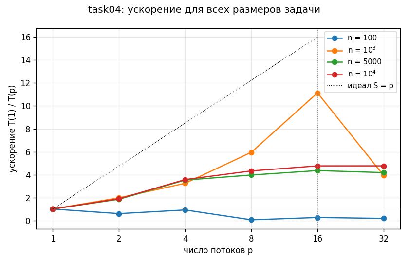

| N | S(2) | S(4) | S(8) | S(16) | S(32) |
|---|---|---|---|---|---|
| 100 | 0.60 | 0.92 | 0.06 | 0.26 | 0.18 |
| 1000 | 2.0 | 3.2 | 6.0 | **11.1** | 3.9 |
| 5000 | 1.9 | 3.5 | 4.0 | 4.4 | 4.2 |
| 10000 | 1.9 | 3.6 | 4.3 | 4.8 | 4.8 |

**Выводы.**
- Лучший случай — N = 1000: матрица занимает 8 МБ и помещается в кэш L3. В этой точке S(16) ≈ 11.
- При N = 5000 и 10000 матрица (200–800 МБ) в кэш не помещается, и задача упирается в память: S ≈ 4.8.
- При N = 100 вся работа занимает около 10 мкс на одном потоке. Накладные расходы перекрывают выигрыш.

## Задача 5. Задача 4 для треугольной и ленточной матриц, разные правила распределения

**Как решено.**
Минимумы ищутся по значимым элементам строки. Хранение плотное, области вне треугольника и полосы пропускаются.

- **Нижнетреугольная матрица:** в строке i значимы элементы с 0 по i, поэтому строки разной длины и
  итерации разной трудоёмкости.
- **Ленточная матрица (|i − j| ≤ N/10):** почти все строки одинаковой длины, это контрольный случай.
- Правила задаются через `schedule(runtime)` и `omp_set_schedule`, так одна функция проверяет все правила:
  - `static` — поровну, блоками подряд, заранее;
  - `static,1` — по одной строке по кругу;
  - `dynamic,1` и `dynamic,16` — свободный поток берёт следующий блок;
  - `guided` — блоки уменьшаются по ходу цикла.

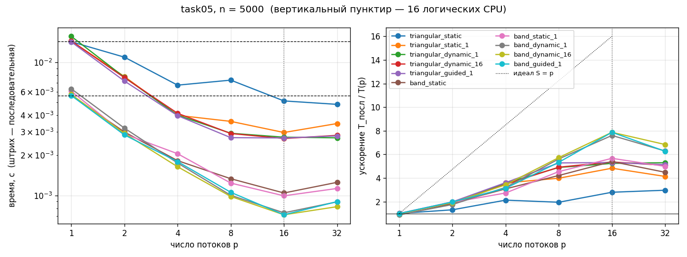
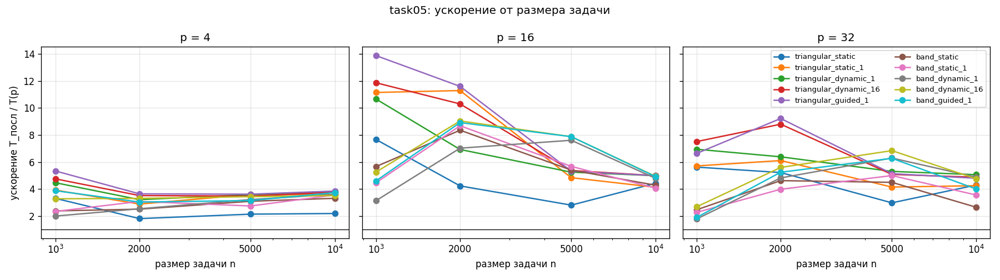

**Время при N = 5000 и p = 16, мс** (последовательно: треугольная 14.4, ленточная 5.6):

| | static | static,1 | dynamic,1 | dynamic,16 | guided |
|---|---|---|---|---|---|
| треугольная | 5.1 | 3.0 | 2.7 | 2.7 | 2.7 |
| ленточная | 1.0 | 1.0 | 0.74 | 0.72 | 0.72 |

**Почему `static` плох на треугольной матрице — расчёт.** При `static` поток k получает k-ю часть строк подряд.
В модели с одинаковыми потоками и одинаковой стоимостью обработки элемента доля работы последнего
потока близка к (2p − 1)/p². Отсюда оценка ускорения p² / (2p − 1).

| p | 2 | 4 | 8 | 16 |
|---|---|---|---|---|
| модель | 1.33 | 2.29 | 4.27 | 8.26 |
| N = 1000 | 1.71 | 3.30 | 3.09 | 7.67 |
| N = 2000 | 1.20 | 1.80 | 2.83 | 4.22 |
| N = 5000 | 1.31 | 2.13 | 1.95 | 2.80 |
| N = 10000 | 1.31 | 2.18 | 3.42 | 4.42 |

При N = 5000 и 10000 и p = 2 и 4 замер близок к модели. При других размерах и числе потоков
разброс больше. Модель учитывает только число элементов в блоке.

При N = 5000 и p = 16 циклический `static,1` уменьшает время треугольного случая с 5.1 до 3.0 мс.
`dynamic` и `guided` дают около 2.7 мс. Для ленточного случая разница меньше в абсолютном времени,
поскольку длина большинства строк одинакова.

## Задача 6. Режимы `schedule` на цикле с неравномерной нагрузкой

**Как решено.**
- Итерация i «тяжёлая», если псевдослучайное значение по модулю n меньше i.
  Она генерирует 1000 случайных чисел. Тяжёлые итерации чаще встречаются к концу цикла.
- Генератор засевается номером итерации, поэтому нагрузка не зависит от числа потоков и порядка выполнения.
- Сравниваются `static`, `static,1`, `static,64`, `dynamic,1`, `dynamic,64`, `guided,1`, `guided,64`.

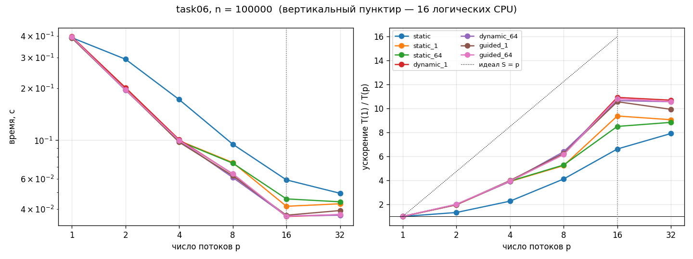
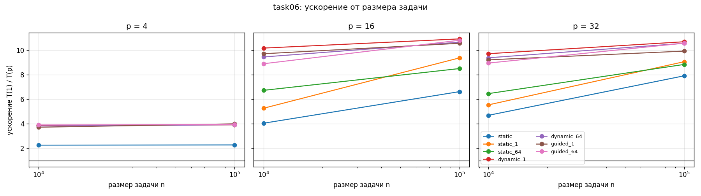

| n = 10⁵ | static | static,1 | static,64 | dynamic,1 | dynamic,64 | guided,1 | guided,64 |
|---|---|---|---|---|---|---|---|
| S(2) | 1.33 | 1.99 | 1.99 | 1.97 | 2.00 | 1.99 | 2.02 |
| S(8) | 4.1 | 5.2 | 5.3 | 6.2 | 6.4 | 6.3 | 6.2 |
| S(16) | 6.6 | 9.4 | 8.5 | **10.9** | 10.7 | 10.6 | 10.8 |

**Выводы.**
- `static` проигрывает по той же причине, что в задаче 5: нагрузка растёт линейно, последний поток получает
  больше всего тяжёлых итераций. При p = 2 получилось S = 1.33, что близко к оценке 4/3.
- `static,1` и `static,64` чередуют лёгкие и тяжёлые итерации. При p = 2 ускорение близко к `dynamic`, при p = 16 разница заметнее.
- `dynamic` и `guided` лучшие: S ≈ 11 при 16 потоках.
- Размер блока (1 или 64) почти ни на что не влияет. Итерация в среднем стоит 4 мкс, это намного дороже, чем
  взять следующий блок из общего счётчика.

## Задача 7. Редукция через `atomic`, `critical`, замки и `reduction`

**Как решено.** Сумма элементов вектора. Сравниваются семь вариантов:
- `reduction(+ : s)` — встроенная редукция;
- `atomic`, `critical`, `lock` (`omp_set_lock`/`omp_unset_lock`) — все потоки прибавляют к одной общей
  переменной на каждой итерации, под соответствующей защитой;
- `atomic_local`, `critical_local`, `lock_local` — каждый поток копит локальную сумму, а к общей переменной
  прибавляет один раз в конце. Это ручная реализация редукции.

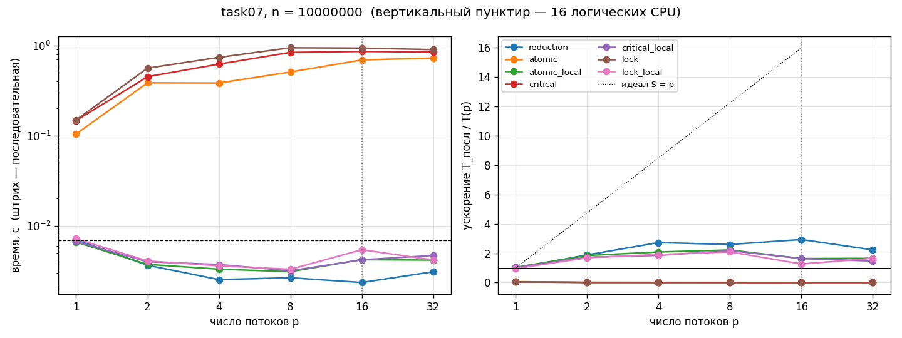
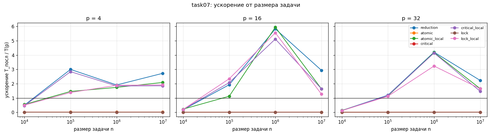

**Время при n = 10⁷, мс** (последовательная версия 6.9 мс):

| p | reduction | atomic | critical | lock | atomic_local | critical_local | lock_local |
|---|---|---|---|---|---|---|---|
| 1 | 7.0 | 104 | 147 | 149 | 6.6 | 6.7 | 7.2 |
| 4 | 2.5 | 384 | 623 | 739 | 3.3 | 3.7 | 3.6 |
| 16 | 2.3 | 692 | 861 | 938 | 4.2 | 4.2 | 5.4 |

**Вывод.** При обновлении общей суммы на каждой итерации потоки конкурируют за одну ячейку.
При p = 16 эти варианты в 100–140 раз медленнее последовательной суммы. В этом замере `atomic`
быстрее критической секции и замка. Для `double` реализация может использовать цикл атомарного
сравнения и обмена. Приватные суммы уменьшают число общих обновлений с n до p. На n = 10⁷
встроенная редукция при 16 потоках дала 2.3 мс, ручные варианты — 4.2–5.4 мс.

## Задача 8. Скалярные произведения набора векторов из файла, `sections`

**Как решено.**
- Пары векторов заранее записаны в бинарный файл: 640 МБ, длина вектора 10⁴, 10⁵ или 10⁶.
- Ввод и вычисление — две раздельные задачи, которые выполняются одновременно.
- Внутри `parallel num_threads(2)` идёт цикл по шагам. На шаге k директива `sections` даёт одному потоку
  секцию «прочитать пару k», а другому — «посчитать пару k − 1».
- Пары читаются в два буфера по очереди (двойная буферизация).
- Синхронизация — неявный барьер в конце `sections`. К следующему шагу прочитанная пара уже готова, а буфер
  посчитанной пары освободился.
- Внутри секции счёта стоит вложенный `parallel for reduction`. Число потоков на графике — это число потоков
  в нём. Вместе с чтением одновременно может работать до p + 1 потоков.

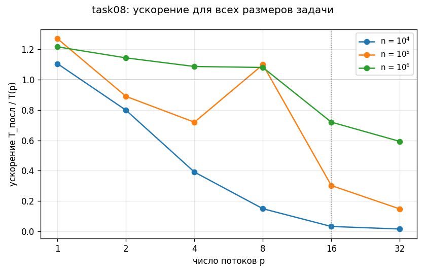

**Сколько занимает каждая часть** (отдельная оценка последовательного чтения и счёта на весь файл):

| длина вектора | чтение | счёт | предел ускорения от перекрытия |
|---|---|---|---|
| 10⁴ | 64 мс | 26 мс | 1.40 |
| 10⁵ | 68 мс | 27 мс | 1.40 |
| 10⁶ | 78 мс | 33 мс | 1.42 |

**Ускорение относительно последовательной версии «прочитал → посчитал»:**

| длина вектора | p = 1 | p = 2 | p = 8 | p = 32 |
|---|---|---|---|---|
| 10⁴ | 1.11 | 0.80 | 0.15 | 0.01 |
| 10⁵ | 1.27 | 0.89 | 1.10 | 0.15 |
| 10⁶ | 1.22 | 1.14 | 1.08 | 0.59 |

**Вывод.** В прогретом замере чтение занимает около 70% суммы времён двух стадий. При полном перекрытии
шаг занимал бы время более медленной стадии, поэтому оценка выигрыша — около 1.4. При одном потоке
на счёт получено 1.1–1.3. Увеличение команды счёта добавляет накладные расходы на каждый вызов `dot`,
а чтение по-прежнему выполняется одним потоком.

## Задача 9. Вложенный параллелизм (на задаче 4)

**Поддержка вложенности.** После `omp_set_nested(1)` функция `omp_get_nested()` возвращает 1, допустимо
до 255 активных уровней по данным среды GCC/libgomp.

**Варианты** (p — общее число потоков):
- `outer` — параллелен внешний цикл по строкам (как в задаче 4);
- `inner` — строки идут по очереди, параллелится поиск минимума внутри строки;
- `nested_2xk` — оба уровня: 2 потока делят строки, каждый для своей строки запускает p/2 потоков;
- `nested_kx2` — наоборот: p/2 потоков делят строки, на каждой строке по 2 потока.

Вложенные варианты измерены только при N ≤ 1000 и p ≤ 16, чтобы ограничить накладные расходы на создание вложенных команд.

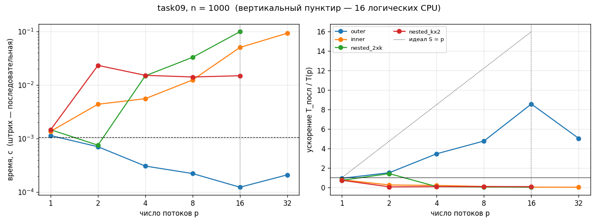
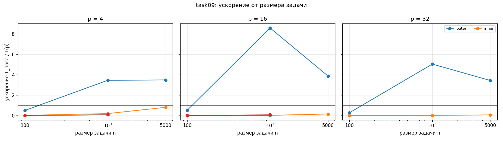

**Время при N = 1000, мс** (последовательная версия 1.06 мс):

| p | outer | inner | nested 2×k | nested k×2 |
|---|---|---|---|---|
| 1 | 1.14 | 1.37 | 1.47 | 1.46 |
| 2 | 0.71 | 4.4 | 0.76 | 23.3 |
| 4 | 0.31 | 5.6 | 14.9 | 15.2 |
| 16 | **0.12** (S = 8.6) | 50.5 | 99.5 | 15.0 |

**Вывод.** При N = 1000 лучший вариант — внешний цикл на 16 потоках (S ≈ 8.6). Он использует
одну команду на всю матрицу. В `inner` на каждую строку приходится отдельная параллельная область,
даже когда потоки переиспользуются. Во вложенном варианте запуск внутренних команд может создавать
новые системные потоки на каждой строке. Поэтому разбиение мелкой работы внутри строки занимает
больше времени, чем сам поиск минимума. При p = 2 вариант `nested_2xk` использует схему 2×1,
так что фактически строки делятся только на внешнем уровне.
